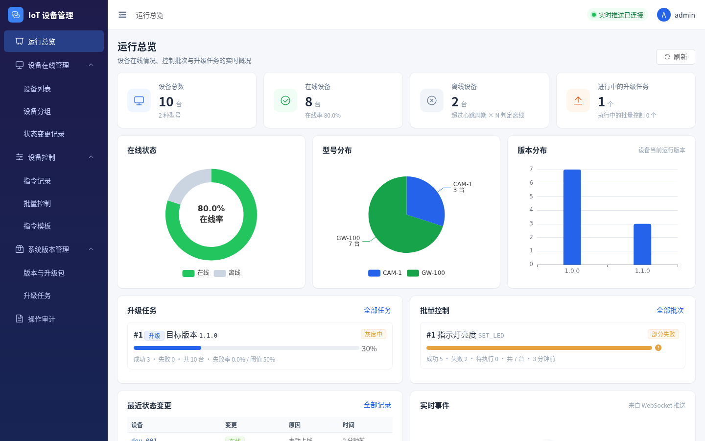
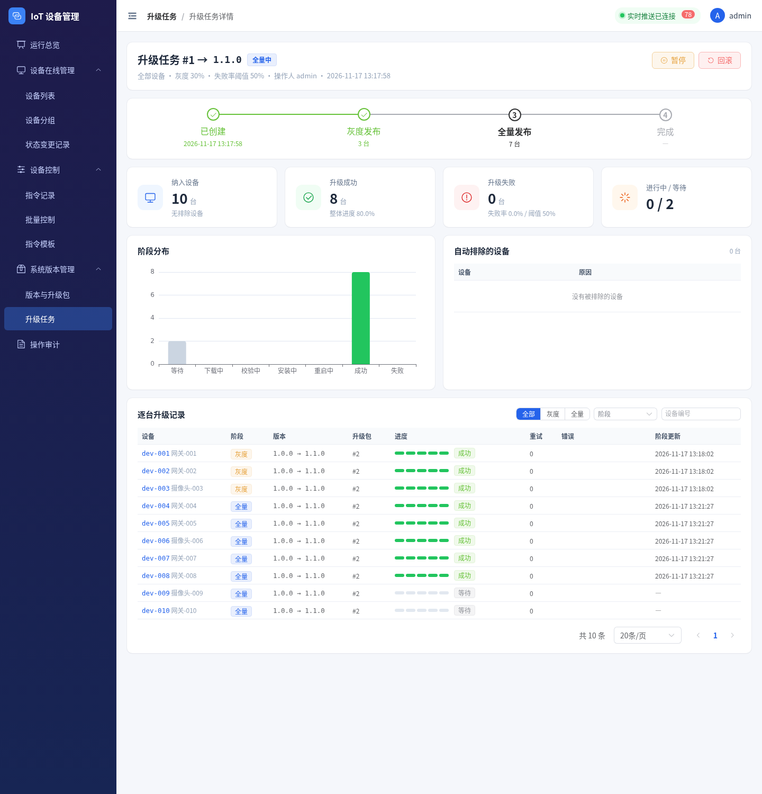
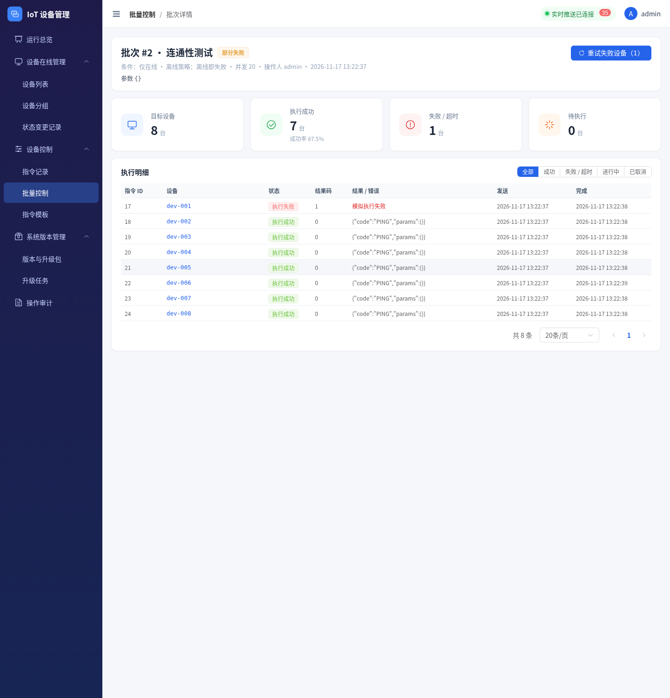
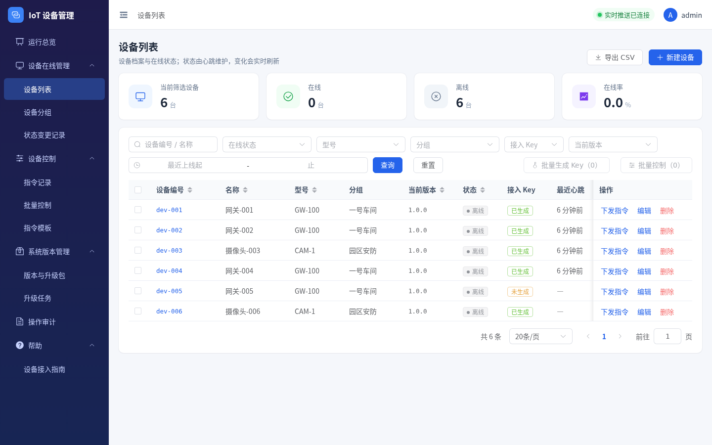
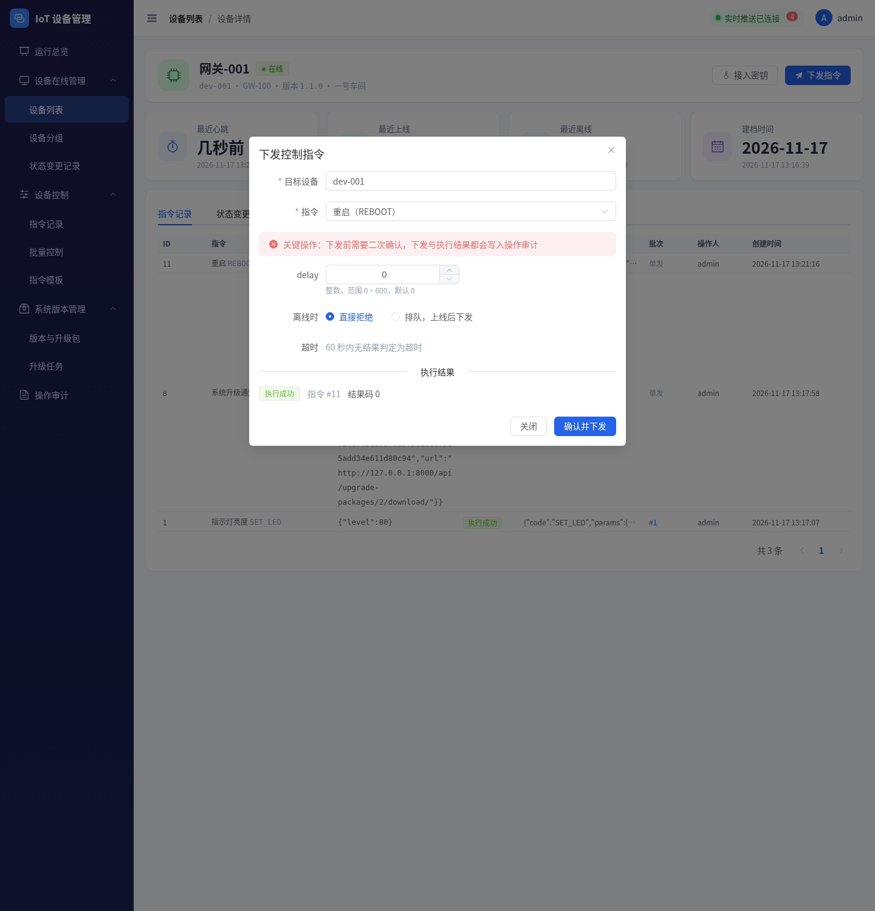
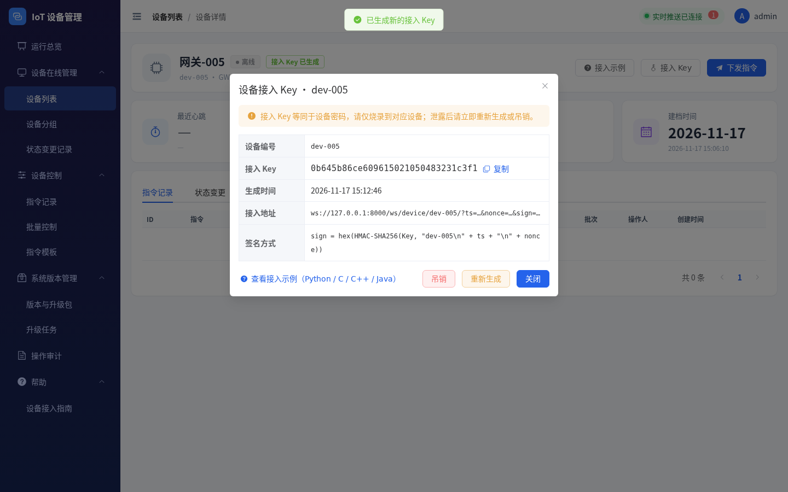
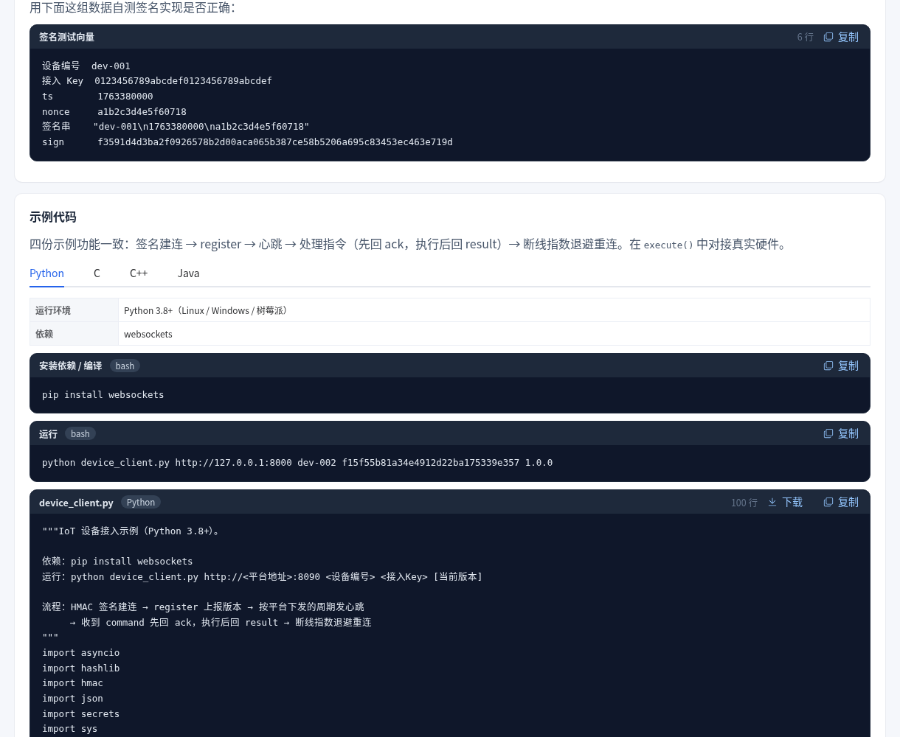
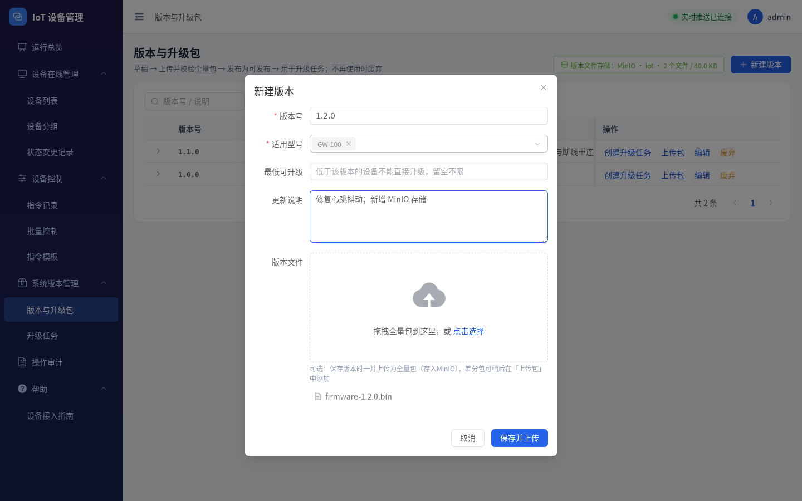
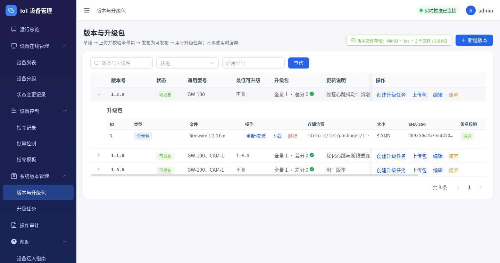

# IoT 设备管理平台

基于 **Django + Django REST Framework + Django Channels** 的物联网设备管理平台，实现
[设计文档](docs/design.md) 中的三大模块：设备在线管理、设备控制、系统版本管理，以及设备档案、
设备通信通道（WebSocket 上行/下行）、任务调度、操作审计等公共支撑。

- REST API 全部采用标准 DRF 形式：`ModelViewSet` / `GenericViewSet` + `Serializer` + `DefaultRouter` + `@action`，
  统一分页 `{"count","next","previous","results"}`、`django-filter` 筛选、`search` / `ordering`、Token 认证。
- 设备长连接与管理端实时推送使用 Channels（单机内存层，配置 `REDIS_URL` 即可多进程部署）。
- 管理端前端：Vue 3 + Vite + Element Plus 单页应用（`frontend/`），实时推送驱动页面刷新，设计见 [docs/frontend.md](docs/frontend.md)。
- 设备接入：管理员**手动生成接入 Key**（单台 / 批量），设备用 HMAC-SHA256 签名建连上线（Key 不上网），
  支持重新生成、吊销与审计；管理端「帮助 → 设备接入指南」附 Python / C / C++ / Java 完整示例（`examples/device/`）。
- 版本文件存储：上传的版本文件（升级包）存入 **MinIO**（S3 兼容，`django-storages`），一键部署自带 MinIO 容器，
  也可接外部 MinIO；新建版本时可直接上传版本文件；设备经平台流式下载，无需直连 MinIO。
- 另有 Django Admin（`/admin/`）、可浏览 API（`/api/`）、设备模拟器与 32 个自动化测试。



## 快速开始

```bash
pip install -r requirements-dev.txt
python manage.py migrate
python manage.py init_demo            # 管理员 admin/admin123、10 台设备、指令模板、1.0.0 与 1.1.0 两个版本
(cd frontend && npm install && npm run build)   # 构建管理端（需要 Node 18+）
python -m daphne -b 0.0.0.0 -p 8000 iot_platform.asgi:application

# 另开终端：模拟 init_demo 生成的全部设备（20% 指令失败率）
python simulator/device_sim.py --file data/demo_devices.json --fail-rate 0.2
```

打开 <http://127.0.0.1:8000/> 用 `admin / admin123` 登录。演示路径：

前端开发时可运行 `cd frontend && npm run dev`，访问 <http://localhost:5173>（自动代理 `/api` 与 `/ws`）。

1. **设备在线管理**：设备上线后实时变绿；停止模拟器，约 90 秒（心跳 30s × 3）后判定离线，点「状态记录」查看原因与持续时长。
2. **设备控制**：给 `dev-001` 下发「重启」（关键操作会弹出二次确认，并写入审计）；用「设备列表 / 分组 / 筛选条件」创建批次，观察并发下发与成功率，失败设备可一键重试。
3. **版本管理**：版本 `1.1.0` 已可发布；新建升级任务（灰度 10%）→ 灰度完成后「推进全量」→ 全部完成；再对任务执行「回滚」到 `1.0.0`。

## 界面

| 升级任务（灰度 → 全量，逐台进度实时刷新） | 批次详情（并发下发、失败可重试） |
|---|---|
|  |  |
| **设备列表（组合筛选、在线统计）** | **关键指令（二次确认，结果实时回显）** |
|  |  |
|  |  |
|  |  |

## 目录结构

```
iot_platform/   settings / urls（DRF Router）/ asgi（HTTP + WebSocket）/ routing
core/           时间源、版本号比较、分页、实时推送（Channel Layer）、调度器、管理命令
devices/        设备档案、分组、在线状态判定、状态变更记录、设备网关（上行处理）、WebSocket Consumer
control/        指令模板、单设备控制、批量控制（并发/离线策略/取消/重试）、超时
firmware/       版本、升级包（SHA-256 + HMAC 签名，本地 / MinIO 存储）、升级任务（灰度/全量/熔断/回滚）、逐台升级记录
audit/          操作审计
frontend/       管理端（Vue 3 + Vite + Element Plus），构建产物 frontend/dist 由 Django 提供
simulator/      设备端模拟器（签名上线 / 心跳 / 应答 / 升级代理）
examples/device/ 设备接入示例：Python、C（Mongoose）、C++（IXWebSocket）、Java（JDK WebSocket）
tests/          pytest（API、状态机、调度、WebSocket 端到端）
docs/           设计文档、前端设计、API 文档、设备通信协议、界面截图
```

## 设计要点与实现对应

| 设计要求 | 实现 |
|---|---|
| 设备接入鉴权 | `devices/auth.py`：接入 Key 由管理员手动生成（`generate-key` / `generate-keys`），HMAC 签名 + 时间戳 + nonce 防重放；失败先回 `auth_failed` 再以 44xx 关闭；生成 / 查看 / 吊销写审计 |
| 心跳 + 连接事件判定在线 | `devices/services.py`：注册/心跳上线；调度扫描 `周期×N` 超时离线并踢掉连接；断开立即离线（以 `connection_id` 区分重连的旧连接） |
| 状态变更留痕 | `DeviceStatusLog`：原因（主动上线/心跳恢复/主动断开/心跳超时）+ 上一状态持续时长 |
| 在线管理是前置条件 | 单发离线时 `409` 或排队；批量离线按策略失败或排队；升级挂起，上线后自动续发 |
| 指令状态机 | PENDING → SENT → DELIVERED → SUCCESS / FAILED，非终态超时 → TIMEOUT（批次取消的待发指令为 CANCELLED） |
| 批量控制 | 范围快照、按并发上限补位下发、实时汇总、取消未下发部分、失败一键重试 |
| 关键操作 | 模板 `is_critical`：接口强制 `confirm=true`，下发与结果都写审计 |
| 升级复用控制通道 | 升级通知是系统指令 `OTA_UPGRADE`，复用下发与回执；拒绝则失败，超时重新挂起（最多 3 次） |
| 升级包 | 上传自动计算 SHA-256、大小，HMAC-SHA256 签名；可选客户端校验值比对；`verify` 重新校验 |
| 发布 / 灰度 / 全量 | 自动排除不符合条件的设备并给出原因；灰度按比例或指定设备；操作人确认推进全量 |
| 失败率熔断 | 失败数 / 当前阶段设备数 > 阈值 → 自动 PAUSED 并审计；继续时已确认的失败不再计入 |
| 版本确认 | 设备重启后上报版本号，等于目标版本 → SUCCESS 并回写档案；否则 FAILED |
| 回滚 | 暂停原任务，为已成功设备生成 ROLLBACK 任务（流程同升级），原任务 ROLLED_BACK |
| 统一审计 | `audit.OperationLog`，可筛选、导出 |

## 配置（环境变量）

| 变量 | 默认 | 说明 |
|---|---|---|
| `IOT_HEARTBEAT_INTERVAL` / `IOT_HEARTBEAT_MISS` | 30 / 3 | 心跳周期（秒）与丢失次数 N |
| `IOT_SCAN_INTERVAL` | 5 | 调度扫描间隔（秒） |
| `IOT_EMBEDDED_SCHEDULER` | 1 | ASGI 进程内运行调度器；多进程部署设为 0 并单独运行 `python manage.py run_scheduler` |
| `IOT_QUEUE_TTL` | 86400 | 离线排队指令最长保留（秒） |
| `IOT_UPGRADE_STAGE_TIMEOUT` | 1800 | 单个升级阶段超时（秒） |
| `IOT_BATCH_CONCURRENCY` | 20 | 批量默认并发 |
| `IOT_SIGN_KEY` | change-me-in-production | 升级包签名密钥 |
| `IOT_PUBLIC_BASE_URL` | http://127.0.0.1:8000 | 下发给设备的升级包下载地址前缀 |
| `IOT_DEVICE_AUTH_MAX_SKEW` | 300 | 设备签名时间戳允许偏差（秒） |
| `IOT_DEVICE_AUTH_ALLOW_PLAIN` | 1 | 是否允许明文 Key（`?secret=`）接入，生产建议 0 |
| `IOT_DATA_DIR` | ./data | SQLite 与（未启用 MinIO 时）升级包存储目录 |
| `IOT_MINIO_ENDPOINT` | — | 设置后版本文件存 MinIO，如 `http://minio:9000` |
| `IOT_MINIO_ACCESS_KEY` / `IOT_MINIO_SECRET_KEY` | — | MinIO 账号 / 密码 |
| `IOT_MINIO_BUCKET` | iot | 存储桶（自动创建） |
| `IOT_MINIO_PREFIX` | — | 可选：对象键前缀 |
| `POSTGRES_DB` 等 | — | 设置后改用 PostgreSQL |
| `REDIS_URL` | — | 设置后使用 Redis Channel Layer |
| `DJANGO_SECRET_KEY` / `DJANGO_DEBUG` / `DJANGO_ALLOWED_HOSTS` | — | Django 基础配置 |
| `IOT_SERVE_STATIC` | 1 | ASGI 进程直接提供静态资源（含前端构建产物） |
| `IOT_FRONTEND_DIST` | frontend/dist | 前端构建产物目录 |

## 测试

```bash
python -m pytest -q
# MinIO 用例（可选）：指向一个可用的 MinIO
IOT_TEST_MINIO_ENDPOINT=http://127.0.0.1:9000 IOT_TEST_MINIO_ACCESS_KEY=admin IOT_TEST_MINIO_SECRET_KEY=<密码> python -m pytest -q
```

覆盖：设备上线/心跳超时/恢复与状态记录、筛选导出、参数校验、关键操作确认与审计、离线拒绝/排队、指令超时、
批量并发补位/离线策略/取消/重试、升级包完整性、版本发布规则、下载鉴权、灰度→全量→完成、离线挂起续升、
版本确认失败、失败率自动暂停/继续/重试、阶段超时、回滚、任务互斥，以及真实 WebSocket 端到端流程。

更多：[前端设计](docs/frontend.md) · [API 文档](docs/api.md) · [设备通信协议](docs/protocol.md) · [设计文档](docs/design.md)

## 部署（Docker 一键部署）

```bash
git clone https://github.com/trep123/IOT.git /opt/iot && cd /opt/iot
sudo bash deploy/deploy.sh            # 国内网络加 --cn --image-mirror docker.m.daocloud.io/library/
```

默认对外端口 8090（Nginx 反向代理，占用时自动顺延），容器只监听 127.0.0.1:18000，PostgreSQL 不映射宿主机端口；
版本文件存内置 MinIO（`--minio-user` / `--minio-password` / `--minio-bucket` 指定账号与存储桶，`--minio-endpoint` 接外部 MinIO）。
完成后打印访问地址与管理员密码。详见 [docs/deploy.md](docs/deploy.md)。
